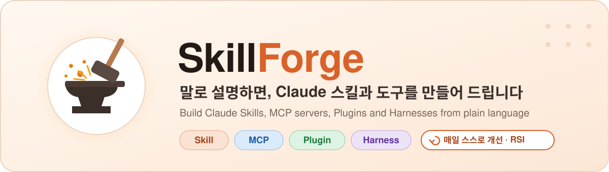
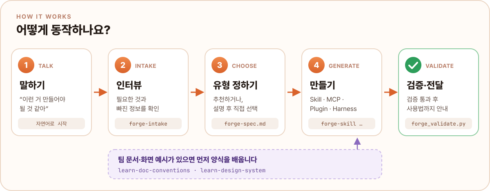
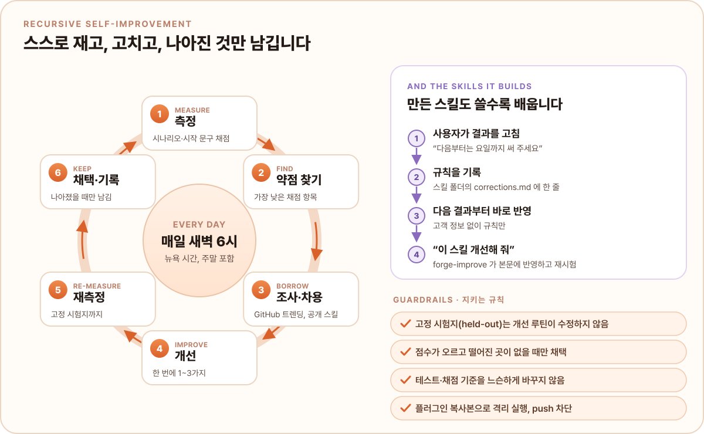
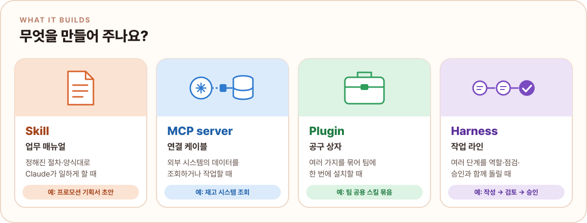
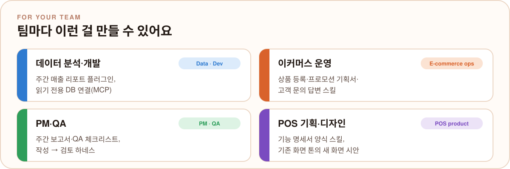
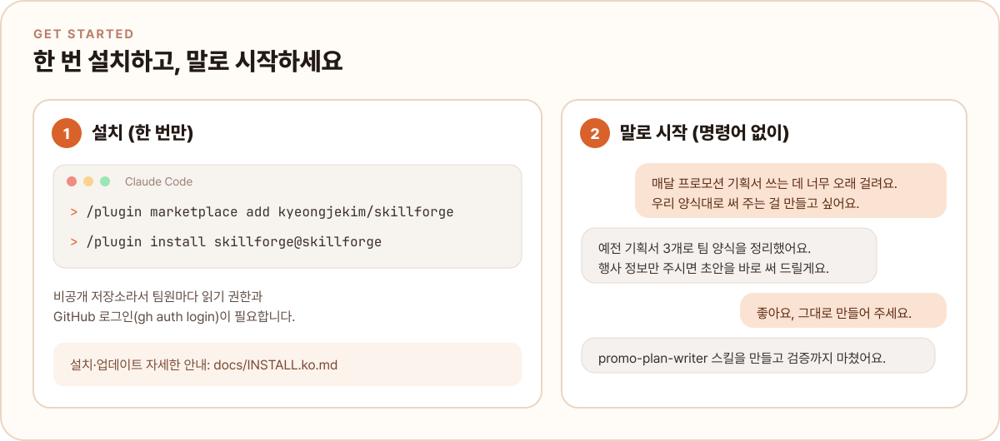

<p align="center">
  
</p>

<p align="center">
  <b>필요한 걸 평소 말로 설명하면</b>, SkillForge가 무엇을 만들지 정하고, 빠진 정보를 묻고,<br>
  Claude <b>Skill · MCP 서버 · Plugin · Harness</b> 로 만들어 검증까지 마칩니다.<br>
  그리고 <b>매일 스스로 채점하고, 가장 약한 곳을 고치고, 나아진 것만 남기며</b> 계속 좋아집니다 (RSI).<br>
  <sub>Describe what you need in plain words. SkillForge picks the right artifact, asks for what's missing, builds it and validates it, and improves itself every day.</sub>
</p>

<p align="center">
  <a href="#-시작하기">시작하기</a> ·
  <a href="#-이렇게-말하면-됩니다">사용 예시</a> ·
  <a href="#-무엇을-만들어-주나요">네 가지 유형</a> ·
  <a href="#-팀별-예시">팀별 예시</a> ·
  <a href="#-스스로-더-좋아집니다-rsi">자기개선 (RSI)</a> ·
  <a href="#-개발">개발</a>
</p>

---

## 🔨 어떻게 동작하나요

<p align="center">
  
</p>

- **슬래시 명령어가 없습니다.** "이런 거 만들어야 될 것 같아", "매번 똑같은 거 반복해" 처럼 말하면 알아서 시작합니다.
- **모호한 곳이 없어질 때까지 인터뷰합니다.** 한 번에 하나씩, 보기와 함께 묻고, 예시 문서가 있으면 먼저 읽고 확인만 합니다.
  만들기 전에 이해한 내용을 되짚어 확인받습니다. 바쁘면 "추천대로 해 주세요" 한마디로 기본값을 한 번에 정합니다.
- **먼저 초안, 나중에 확인.** 만든 스킬은 정보가 조금 모자라도 초안부터 쓰고, 확인할 곳을 `[확인 필요]` 로 표시합니다.
- **한 번만 하는 일에는 끼어들지 않습니다.** "PRD 한 개만 써 줘", "이 엑셀 수식 왜 에러 나요?" 같은 요청은 평소처럼 처리합니다.

## 🔁 스스로 더 좋아집니다 (RSI)

<p align="center">
  
</p>

SkillForge는 **재귀적 자기개선(RSI, Recursive Self-Improvement)** 구조로 만들어져 있습니다.
"한 번 만들고 끝"이 아니라, 스스로를 재고 고치는 과정을 매일 반복합니다.

1. **측정합니다.** 가상 팀원(숨은 정답과 성격을 가진 다른 모델)이 SkillForge와 처음부터 끝까지 대화하고, 만들어진 스킬을 새 세션에서 실제로 씁니다.
   판정 모델이 [채점 기준표](tests/e2e/rubric.md)로 인터뷰, 숨은 정답 반영, 팀 양식, 바로 쓸 수 있는지, 결과 문서 품질, 예외·안전 **6개 항목을 0~5점**으로 매기고,
   커밋·푸시·자격증명 접근·검증 실패 같은 기계 점검과 합칩니다.
2. **가장 약한 곳을 찾습니다.** 평균이 가장 낮은 항목과 실패한 시나리오를 고릅니다.
3. **밖에서 배워 옵니다.** 매일 새벽 6시(뉴욕) 루틴이 GitHub 트렌딩, 공개 Claude 스킬·플러그인·MCP 서버를 살펴 그 약점에 맞는 방법을 찾습니다.
4. **조금만 고칩니다.** 한 번에 1~3가지만 바꿔야 무엇이 효과였는지 알 수 있습니다.
5. **다시 잽니다.** 개발용 시나리오와, 개선 과정에서 **절대 수정하지 않는 고정 시험지(held-out)** 를 함께 돌립니다.
6. **나아진 것만 남깁니다.** 약한 항목이 오르고 다른 항목과 고정 시험지가 떨어지지 않을 때만 채택하고, 아니면 되돌립니다.
   결과는 [개선 기록 (docs/IMPROVEMENT_LOG.md)](docs/IMPROVEMENT_LOG.md)에 점수 전후, 차용한 출처, 배운 점과 함께 남습니다.

**만든 스킬도 배웁니다.** 결과를 고치면서 "다음부터는 요일까지 써 주세요" 라고 하면, 스킬이 그 규칙을 `corrections.md` 에 남기고 다음 결과부터 따릅니다.
"이 스킬 개선해 줘" 라고 하면 `forge-improve` 가 기록을 스킬 본문에 반영하고, 문제가 났던 예시와 잘 되던 예시를 둘 다 다시 돌려 **나빠진 곳이 없을 때만** 남깁니다.

> [!IMPORTANT]
> 점수를 올리려고 테스트나 채점 기준을 느슨하게 바꾸는 것은 금지입니다. 고정 시험지와 채점 기준표는 해시로 잠겨 있고 단위 테스트가 변경을 잡아냅니다.
> 모든 시험은 플러그인 복사본으로, push가 막힌 격리 폴더에서 돌아갑니다. 자세한 규칙: [docs/PLAN.md 12장](docs/PLAN.md#12-재귀적-자기개선-rsi-recursive-self-improvement)

**첫 측정 결과** (2026-11-05, 가상 팀원 34개 시나리오, 저비용 `sweep` 모드. 6개 항목은 개발용 평균, 0~5점)

| 항목 | 기준선 | 1차 개선 후 |
| --- | :---: | :---: |
| 시나리오 통과 (개발용) | 13/29 | **16/29** |
| 시나리오 통과 (고정 시험지) | 3/5 | **4/5** |
| 시작해야 할 때 시작하고, 아닐 때 가만히 있기 | 50/56 | **59/59** |
| 인터뷰 | 3.41 | **3.71** |
| 숨은 정답 반영 | 4.09 | **4.36** |
| 팀 양식 | 3.59 | **3.95** |
| 바로 쓸 수 있는지 | 3.05 | **3.68** |
| 결과 문서 품질 | 3.32 | **3.59** |
| 예외·안전 | 3.73 | **3.77** |

같은 날 시도한 2차 개선은 개발용 점수는 올랐지만 고정 시험지가 떨어져서 **되돌렸습니다.**
나아진 것만 남긴다는 규칙이 실제로 작동한 첫 사례입니다. 모든 숫자와 비용은 [개선 기록](docs/IMPROVEMENT_LOG.md)에 있습니다.
점수는 실제 팀 문서가 아닌 합성 예시와 가상 팀원으로 잰 것이고, 통과 기준(모든 항목 3점 이상, 평균 4점 이상)은 일부러 높게 잡았습니다.

## 🧰 무엇을 만들어 주나요

<p align="center">
  
</p>

어떤 걸 만들어야 할지 몰라도 괜찮습니다. SkillForge가 추천하거나, 네 가지를 설명하고 직접 고르게 해 드립니다.

## 👥 팀별 예시

<p align="center">
  
</p>

팀마다 시작용 템플릿이 들어 있습니다: [데이터·개발](plugins/skillforge/templates/teams/data-dev.md) ·
[이커머스 운영](plugins/skillforge/templates/teams/ecommerce-ops.md) ·
[PM·QA](plugins/skillforge/templates/teams/pm-qa.md) ·
[POS 기획·디자인](plugins/skillforge/templates/teams/pos-product.md)

## 🚀 시작하기

<p align="center">
  
</p>

Claude Code에서 아래 두 줄을 입력합니다.

```text
/plugin marketplace add kyeongjekim/skillforge
/plugin install skillforge@skillforge
```

> [!NOTE]
> 비공개 저장소라서 팀원마다 **저장소 읽기 권한**과 **GitHub 로그인**(`gh auth login`)이 필요합니다.
> MCP 서버를 만들 때만 **Python 3.10 이상**이 필요합니다.
> 준비물, 업데이트, 문제 해결은 [설치 안내 (docs/INSTALL.ko.md)](docs/INSTALL.ko.md)에 있습니다.

## 💬 이렇게 말하면 됩니다

| 이렇게 말하면 | 시작되는 것 | 결과 |
| --- | --- | --- |
| "매달 프로모션 기획서 쓰는 게 오래 걸려요. 우리 양식대로 써 주는 걸 만들고 싶어요" | `forge-intake` → `learn-doc-conventions` → `forge-skill` | 기획서 스킬 |
| "우리 재고 시스템이랑 Claude를 연결하고 싶어요" | `forge-intake` → `forge-mcp` | 읽기 전용 MCP 서버 뼈대 |
| "기존 POS 화면이랑 톤 맞춰서 새 화면 만들어 줘" | `learn-design-system` | 디자인 양식 + 화면 명세 + HTML 시안 |
| "이 스킬들 팀원들이 설치해서 쓰게 묶어 줘" | `forge-plugin` | 팀 설치용 플러그인 |
| "명세서 쓰고 리뷰어가 검토하는 흐름 만들어 줘" | `forge-harness` | 작성·검토 에이전트 + 자동 점검 훅 |
| "Skill이랑 MCP랑 뭐가 달라요?" | `forge-intake` | 네 가지 유형 설명과 추천 |
| "저번에 만든 기획서 스킬이 자꾸 목표 매출을 빼먹어요. 고쳐 주세요" | `forge-improve` | 수정 기록을 반영하고 다시 시험한 스킬 |

## ✅ 품질 확인

만드는 모든 결과물은 넘겨 드리기 전에 검증합니다.

- **검증기** `forge_validate.py`: 스킬 설명과 자동 실행 문구, 빈칸 남김, 깨진 링크, 훅·MCP가 부르는 파일이 실제로 있는지,
  하드코딩된 토큰, 팀원 설정(userConfig)까지 확인합니다. Claude Code 공식 검증(`claude plugin validate`)도 함께 돌립니다.
- **단위 테스트** (`tests/`): 검증기, 템플릿, 훅 스크립트, Office·한글 문서 읽기, Claude 앱용 압축, 고정 시험지 잠금을 확인합니다. 표준 라이브러리만 씁니다.
- **채점 장치** [`tests/e2e`](tests/e2e): 위 [자기개선](#-스스로-더-좋아집니다-rsi)에서 쓰는 시나리오, 가상 사용자, 채점 기준표, 시작 문구 점검입니다.
  서브팀 4곳의 까다로운 사람(모호함, 귀찮음, 말 바꿈, 용어 모름)과 악성 지시가 숨은 예시, 비밀번호·다른 저장소 요청까지 들어 있습니다.

## 🗂 구성

```text
skillforge/
├── .claude-plugin/marketplace.json     # 이 저장소를 설치 가능한 마켓플레이스로 만듭니다
├── assets/                             # README 이미지 (SVG, 글자를 윤곽선으로 굳힌 빌드 결과물)
│   └── src/                            # 이미지 원본: 고칠 때는 여기를 고치고 build
├── docs/
│   ├── INSTALL.ko.md                   # 팀원용 설치·사용 안내
│   ├── PLAN.md                         # 목표, 심층 인터뷰, 자기개선(RSI) 규칙, 남은 질문
│   ├── IMPROVEMENT_LOG.md              # 자기개선 기록: 날짜별 점수 전후, 바꾼 것, 배운 점
│   └── PROACTIVE.md                    # 먼저 제안하는 모드 설계 메모 (미구현)
├── plugins/skillforge/
│   ├── .claude-plugin/plugin.json
│   ├── skills/
│   │   ├── forge-intake/               # 인터뷰, 빠진 정보, 유형 추천·설명
│   │   ├── forge-skill/                # Skill 생성 + SKILL.template.md
│   │   ├── forge-mcp/                  # MCP 서버 생성 + Python 템플릿 (MCP SDK 2.x)
│   │   ├── forge-plugin/               # Plugin 생성 + plugin/marketplace 템플릿
│   │   ├── forge-harness/              # Harness 생성 + 에이전트·훅 템플릿, 필수 섹션 점검 스크립트
│   │   ├── forge-improve/              # 사용자 수정 기록(corrections.md)으로 기존 스킬 개선
│   │   ├── learn-doc-conventions/      # 예시 문서에서 팀 양식(style-guide.md) 추출
│   │   └── learn-design-system/        # 화면 캡처에서 디자인 양식 추출, 새 화면 시안
│   ├── templates/teams/                # 서브팀별 시작 템플릿
│   └── scripts/
│       ├── forge_validate.py           # 모든 생성 단계가 쓰는 검증기
│       ├── extract_text.py             # .docx / .xlsx / .pptx / .hwpx / .hwp 텍스트 추출
│       └── package_skill.py            # Claude 앱(웹·데스크톱 채팅) 업로드용 스킬 압축
├── scripts/readme_assets.py            # README 이미지 빌드·넘침 검사
└── tests/
    ├── test_forge_validate.py          # 단위 테스트
    ├── test_readme_assets.py           # README 이미지 넘침·가림 검사
    └── e2e/                            # 채점 장치 (선택, Claude 사용량 발생)
        ├── scenarios/  heldout/        # 개발용 시나리오 / 고정 시험지 (수정 금지)
        ├── rubric.md                   # 채점 기준표 (6개 항목, 0~5점)
        ├── run.py                      # sweep(저렴) · full(실전) 모드 실행
        └── fixtures/                   # 팀별 가상 예시 문서·화면
```

템플릿 파일은 `*.template.*` 이름을 쓰고, 채워야 할 곳은 `{{SF: ...}}` 로 표시합니다.
`{{customer_name}}` 같은 일반 치환 필드는 그대로 둘 수 있습니다.

## 🛠 개발

```bash
# 단위 테스트 (Python 3.9+, 표준 라이브러리만)
python3 -m unittest discover -s tests -v

# 플러그인과 마켓플레이스 검증
python3 plugins/skillforge/scripts/forge_validate.py marketplace .
claude plugin validate .

# SkillForge가 만든 결과물 검증
python3 plugins/skillforge/scripts/forge_validate.py skill  path/to/skill-dir
python3 plugins/skillforge/scripts/forge_validate.py plugin path/to/plugin-dir
python3 plugins/skillforge/scripts/forge_validate.py mcp    path/to/server-dir

# 채점 장치 (claude CLI 필요, 사용량 발생; 비용은 docs/IMPROVEMENT_LOG.md 기준선 참고)
python3 tests/e2e/run.py --mode sweep              # 저렴하게 넓게: 전체 시나리오 + 시작 문구
python3 tests/e2e/run.py --mode full --set heldout # 실전 모델로 고정 시험지
python3 tests/e2e/run.py ec-listing-lazy           # 시나리오 하나만
```

README 이미지를 고칠 때는 `assets/src/` 의 원본을 고친 뒤 다시 만듭니다.
GitHub는 README 속 SVG 글자를 보는 사람 컴퓨터의 글꼴로 그려서, 글꼴에 따라 글자가 상자 밖으로 넘칠 수 있습니다.
그래서 빌드할 때 글자를 고정 글꼴(Pretendard, JetBrains Mono)의 윤곽선으로 바꾸고, 검사는 넓은 대체 글꼴로도 넘치지 않는지 확인합니다.

```bash
pip install -r scripts/requirements-readme-assets.txt
python3 scripts/readme_assets.py build            # assets/src/*.svg -> assets/*.svg
python3 scripts/readme_assets.py check            # 넘침·겹침·빌드 누락이면 실패
python3 scripts/readme_assets.py render /tmp/prev # 밝은·어두운 배경 PNG 미리보기
```

새 버전을 낼 때는 `plugin.json` 과 `marketplace.json` 의 `version` 을 함께 올립니다
(테스트가 두 값이 같은지 확인합니다).

## 🧭 앞으로

[docs/PLAN.md](docs/PLAN.md)에 목표와 남은 질문이 있습니다. 아직 없는 것:

- **먼저 제안하는 모드:** 일하는 패턴을 보고 도구를 먼저 제안합니다. 설계 메모만 있습니다 ([docs/PROACTIVE.md](docs/PROACTIVE.md)).
- **Claude Desktop · 웹 지원:** 지금은 Claude Code 플러그인입니다.

---

<p align="center"><sub>Made by <a href="https://github.com/kyeongjekim">@kyeongjekim</a></sub></p>
